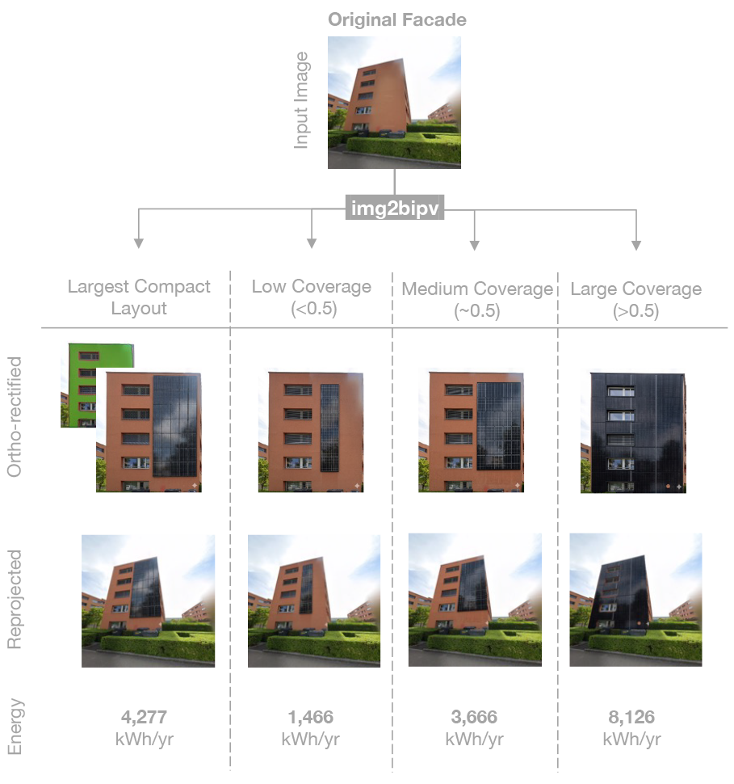

## An automated pipeline for facade solar retrofits using 3D reconstruction and generative image editing 

[Ayca Duran](https://systems.arch.ethz.ch/ayca-duran), [Christoph Waibel](https://systems.arch.ethz.ch/christoph-waibel), [Bernd Bickel](https://berndbickel.com/about-me),  [Iro Armeni](https://ir0.github.io), [Arno Schlueter](https://systems.arch.ethz.ch/arno-schlueter)

[[ Paper ]](https://papers.ssrn.com/sol3/papers.cfm?abstract_id=5988643) [under review]

<p align="center">
  
</p>

This repository contains the pipeline that enables automated analysis of facades and visualization of building-integrated photovoltaics (BIPV) facade retrofits from street-level imagery. It combines feed-forward 3D reconstruction, vision-language models (VLMs), and generative image editing to estimate facade geometry, visualize retrofit designs, and evaluate energy potential.

---

## Pipeline overview

The workflow is organized as four sequential notebooks:

1. **`0_dust3r_pipe.ipynb`**  
   3D reconstruction, facade masking, gravity alignment, and orthorectification.

2. **`1_vlm_scale_pred.ipynb`**  
   Metric scale estimation (width, height, floors) using vision-language models.

3. **`2_generate_bipv_retrofit.ipynb`**  
   Scale-aware BIPV visualization using diffusion models and optional Gemini-based editing.

4. **`3_solar_energy.ipynb`**  
   Estimation of deployable PV area and energy-related KPIs.


## Repository layout

```text
facade2dim/
├── notebooks/
├── data/
│   └── demo/
│       └── input/
│           ├── images/
│           ├── masks/
│           └── metadata.csv
├── outputs/
├── assets/
├── external/
├── environments/
│	├── image2bipv-geom.yml
│	└── image2bipv-gen.yml
├── requirements.txt
└── .gitignore
```

## Setup

1. Clone repository

```bash
git clone https://github.com/ycdrn/image2bipv.git
cd image2bipv
```

2. Create environments

This repository uses two conda environments:

- `envs/image2bipv-geom.yml` for:
  - `0_dust3r_pipe.ipynb`
  - `1_vlm_scale_pred.ipynb`

- `envs/image2bipv-gen.yml` for:
  - `2_generate_bipv_retrofit.ipynb`
  - `3_solar_energy.ipynb`

Create them with:

```bash
conda env create -f envs/image2bipv-geom.yml
conda env create -f envs/image2bipv-gen.yml
```

## External data

**Sonnenfassade**:
Notebook `3_solar_energy.ipynb` requires a Sonnenfassade dataset in .gpkg format. 
It can be downloaded from [opendata.swiss](https://opendata.swiss/de/dataset/eignung-von-hausfassaden-fur-die-nutzung-von-sonnenenergie). 
Place this file inside: 
```text
external/sonnenfassade/
```

**DUSt3R**:
The 3D reconstruction pipeline relies on DUSt3R. Install and download it following the official repository of [DUSt3R](https://github.com/naver/dust3r).
Place your local clone under:
```text
external/dust3r/
```

**GeoCalib**:
Camera calibration and gravity alignment rely on GeoCalib. Install and download it following the official repository of [GeoCalib](https://github.com/cvg/GeoCalib).
Place your local clone under:
```text
external/geocalib/
```

**Segformer**:
Automated BIPV layout generation relies on a fine-tuned Segformer model. Details of fine-tuning and layout generation are available in [segment4pvlayout](https://github.com/ycdrn/segment4pvlayout). Download the checkpoint from [HuggingFace](https://huggingface.co/aycaduran/cmp_segformer). 
Place the checkpoint under:
```text
external/segformer/
```


## Notes

The notebooks were developed and tested in conda environments using GPU acceleration. The following are recommended:

- NVIDIA GPU with CUDA support
- compatible PyTorch + CUDA installation
- sufficient VRAM for diffusion and 3D reconstruction models

Tested software stack includes the following for Geometry/Generation environments:

- Python 3.11/3.10
- PyTorch 2.5/2.5
- CUDA 12.1/12.4


## Citation
If you use this pipeline, please cite:
```bibtex
@article{duran2025image2bipv,
  title   = {An Automated Pipeline for Facade Solar Retrofits Utilizing 3D Reconstruction and Diffusion Models},
  author  = {Duran, Ayca and Waibel, Christoph and Bickel, Bernd and Armeni, Iro and Schlueter, Arno},
  year    = {2025},
  doi     = {10.2139/ssrn.5988643},
  url     = {https://papers.ssrn.com/sol3/papers.cfm?abstract_id=5988643},
  note    = {SSRN Preprint}
}
```

## References
- [DUSt3R](https://github.com/naver/dust3r)
- [GeoCalib](https://github.com/cvg/GeoCalib)
- [SegFormer](https://github.com/NVlabs/SegFormer) 
- [Sonnenfassade.ch](https://opendata.swiss/de/dataset/eignung-von-hausfassaden-fur-die-nutzung-von-sonnenenergie)


